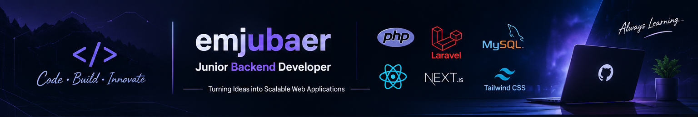

 
<!--
  GitHub Profile README for @emjubaer
-->

  

<h1 align="center">Hi, I'm Ehsanul Mahbub Jubaer 👋</h1>

<h3 align="center">Junior Back-End Developer | PHP • Laravel • Node.js</h3>

  Focused on building reliable backend applications, designing RESTful APIs,
  and developing maintainable software solutions.

  
  

---

## 👨‍💻 About Me

I'm a Junior Back-End Developer with a strong interest in building reliable, scalable, and maintainable web applications.

- 🎓 Computer Science and Engineering student.
- 💻 Primarily focused on PHP and Laravel backend development.
- 🏗️ Interested in backend architecture, API design, database architecture, and application performance.
- 🧩 Enjoy translating real-world requirements into practical software solutions.
- 🌱 Currently expanding my backend development skills with Node.js while continuing to strengthen my Laravel expertise.
- 🚀 Believe in writing clean, maintainable code and continuously improving through hands-on projects.

## 🎯 Current Focus

- Developing RESTful APIs and backend applications using Laravel.
- Exploring Node.js and its ecosystem for server-side development.
- Improving application architecture through service-based design and separation of concerns.
- Working with MySQL, database relationships, query optimization, and data integrity.
- Strengthening API integration, error handling, and application performance.
- Building practical projects to improve problem-solving and software engineering skills.

## 🧰 Tech Stack

### Backend

  

### Frontend

  

### Tools

  

## 🚀 Featured Projects

### 1. Support Ticket System

A Laravel-based support ticket platform with a REST API and web dashboards for admins, agents, and customers.

- Role-based access for `admin`, `agent`, and `customer`.
- Laravel Sanctum API authentication.
- Ticket lifecycle, assignment, priority management, and conversations.
- Form Request validation, API Resources, Policies, and PHP Enums.
- Database notifications and realtime-broadcasting foundations.

**Built with:** PHP, Laravel 12, MySQL, Sanctum, Tailwind CSS, Laravel Reverb.

### 2. TinyLink - URL Shortener API

A REST API for creating, managing, and tracking shortened URLs.

- Token-based authentication with Laravel Sanctum.
- User-owned URLs protected by authorization policies.
- Short-link redirects and click-count tracking.
- URL management and per-link statistics endpoints.

**Built with:** PHP 8.3+, Laravel 13, MySQL, Laravel Sanctum.

### 3. DevStack

A React application for exploring development technologies and building a personal tech stack.

- Browse technology cards by category and difficulty.
- Add technologies to a personal stack and remove selections.
- Responsive interface with toast notifications.

**Built with:** React, TypeScript, Vite, Tailwind CSS.

## 📊 GitHub Statistics

  

  
  

  

## 📈 Contribution Activity

  

## 🌱 Currently Learning

- Node.js and server-side JavaScript development
- Backend application architecture and API development
- Advanced Laravel concepts and best practices
- Database optimization and system design fundamentals

## 🤝 Connect With Me

  
  

---

  <i>Building, learning, and improving one commit at a time.</i> 🚀

